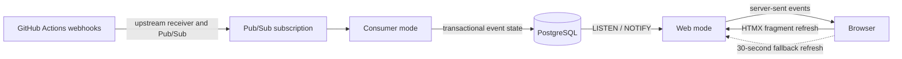

# Architecture

The project builds one Go container image. Start separate instances of that image in `consumer` and `web` modes, and run `migrate` as a one-shot deployment step before either runtime mode. Runtime modes check that the schema exists but do not migrate it implicitly. The web and consumer modes also expose `/healthz` and `/readyz` on `HTTP_ADDR`.

The consumer reads workflow events already published to a configured Pub/Sub subscription. It handles `workflow_run` and `workflow_job` deliveries, deduplicates delivery IDs, and applies ordered state updates transactionally. Job-only deliveries can create provisional run rows until an authoritative workflow event arrives. The system observes webhook activity; it does not fetch historical runs or query GitHub to reconcile missed deliveries. A missed event can therefore leave a run's displayed state stale.

PostgreSQL stores each run attempt and its job details. The dashboard displays only the latest attempt for each repository and workflow run, includes job and step details inline, and retains completed history for seven days. Active work is kept visible even if it becomes stale. The consumer periodically removes expired completed runs and old delivery-deduplication records.

When a committed update sends PostgreSQL `NOTIFY`, the web mode's dedicated `LISTEN` connection signals connected browsers through server-sent events (SSE). The browser uses HTMX to request an updated dashboard fragment. A 30-second periodic refresh recovers missed notifications, and the SSE stream reconnects after connection loss.

The UI, CSS, small browser helper, and HTMX 2.0.11 are embedded in the Go binary and served locally. No third-party script is loaded from a CDN. HTMX is vendored under the Zero-Clause BSD terms in [`static/htmx.LICENSE`](../internal/web/static/htmx.LICENSE). The implementation follows the [HTMX documentation](https://htmx.org/docs/) for fragment requests and the [GitHub webhook event and payload reference](https://docs.github.com/en/webhooks/webhook-events-and-payloads) for event payloads.
