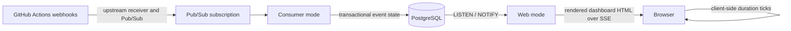

# Architecture

The project builds one Go container image. Start separate instances of that image in `consumer` and `web` modes, and run `migrate` as a one-shot deployment step before either runtime mode. Runtime modes check that the schema exists but do not migrate it implicitly. The web and consumer modes also expose `/healthz` and `/readyz` on `HTTP_ADDR`.

The consumer reads workflow events already published to a configured Pub/Sub subscription. It allows eight in-flight messages while serializing payload decoding to bound transient memory, and acknowledges each message only after its database transaction commits. It handles `workflow_run` and `workflow_job` deliveries, deduplicates delivery IDs, and applies ordered state updates transactionally. Job-only deliveries can create provisional run rows until an authoritative workflow event arrives. The system observes webhook activity; it does not fetch historical runs or query GitHub to reconcile missed deliveries. A missed event can therefore leave a run's displayed state stale.

PostgreSQL stores each run attempt and its job details. The dashboard displays the latest attempt for each workflow run, and a completed run is superseded as soon as a newer run of the same workflow and branch is observed, so a retriggered workflow leaves the failed lane even when GitHub assigned it a new run id. Completed records remain in the database for seven days, while the board shows non-failure terminal outcomes (including success, cancelled, skipped, and neutral) for ten minutes and failures for 24 hours. Active work remains visible even when its events stop changing. The consumer periodically removes expired completed runs and old delivery-deduplication records.

When a committed update sends PostgreSQL `NOTIFY`, the web mode's dedicated `LISTEN` connection schedules a snapshot and renders the board for connected browsers. An SSE event carries a JSON envelope containing the rendered HTML and repository list; the browser does not make a follow-up GET to refresh the board. Notifications are coalesced for 500 milliseconds, and the server sends a fresh snapshot every 30 seconds to advance display windows and recover from lost notifications. Run durations tick locally in the browser between updates.

The dashboard keeps the repository selector and run-details modal outside the live-updated board; HTMX swaps only the board. It presents four workflow groups: queued runs, running runs, non-failure completions from the last ten minutes, and failed runs from the last 24 hours. Workflow counts and queued/running job counts are shown separately. Queued and running jobs are grouped by their requested runner-label sets, sorted for consistent grouping; counts do not identify individual assigned runner hosts. A run's details open in a modal.

The UI, CSS, browser helper, and HTMX 2.0.11 are embedded in the Go binary and served locally. No third-party script is loaded from a CDN. HTMX is vendored under the Zero-Clause BSD terms in [`static/htmx.LICENSE`](../internal/web/static/htmx.LICENSE). The implementation follows the [HTMX documentation](https://htmx.org/docs/) and the [GitHub webhook event and payload reference](https://docs.github.com/en/webhooks/webhook-events-and-payloads).
